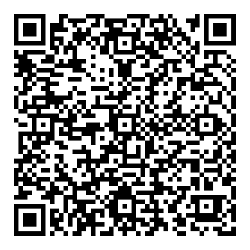

# MotoNav

App Android que projeta **navegação, mapa e um painel esportivo ("Race") na tela TFT de motos que usam o
app Carbit Ride / EasyConn** para espelhar o celular. Usa mapas e rotas gratuitos, conecta sozinho e
funciona com a tela do celular apagada.

> **Projeto independente e sem fins lucrativos.** Não é afiliado, patrocinado nem aprovado pela Zontes,
> pela Carbit/EasyConn ou por qualquer fabricante. Nomes de marcas aparecem só para dizer com qual
> hardware o app foi testado. Use por sua conta e risco e **não mexa no celular pilotando**.

Testado em: **Zontes T350X** (painel `ZHKJ08-1122`, 800×480) com um Samsung Galaxy (Android 16).
Outros painéis que usam o mesmo app de espelhamento talvez funcionem. Se testar o seu, abra uma issue
contando como foi.

**Painéis de 2025 em diante** (um QR só, com `ID:CARBIT…` embaixo) conectam de outro jeito: pelo
Bluetooth, com o painel entrando num hotspot criado pelo celular. Desde a v1.1 o app reconhece o QR e
escolhe o caminho sozinho. Esse modo foi feito com base no projeto aberto
[ZC-Panel](https://github.com/luan441-s/ZC-Panel) e **ainda está em teste**: se tiver uma moto dessas,
use **Enviar relatório** e conte como foi.

**[⬇ Baixar o app](https://github.com/EpaminondasDiniz/motonav/releases/latest/download/MotoNav.apk)** ·
**[📄 Guia de instalação (PDF)](docs/Guia-MotoNav.pdf)** ·
**[☕ Apoie o projeto (Pix)](#-apoie-o-projeto)**

## O que faz

**No painel da moto**
- Mapa com a rota e a seta da próxima conversão, a distância, o tempo restante e o horário de chegada.
- Recalcula a rota sozinho quando você sai dela.
- Trânsito em tempo real, incidentes (acidente, via fechada, obras) e rota com trânsito, usando a
  sua **própria chave gratuita da TomTom** (opcional; sem ela as rotas vêm do Valhalla/OSRM).
- Radares fixos e limite de velocidade da rua (OpenStreetMap), com o velocímetro em vermelho acima do limite.
- Modo noturno automático pelo pôr do sol e zoom que muda com a velocidade.
- **Painel Race** com 5 estilos: Neon, Clássico, Retrô, Caça (HUD) e Telemetria.
- Animação de entrada com o seu nome e tela de chegada com os números da viagem.
- Música tocando (Spotify ou outro player) com capa e progresso, e aviso de mensagens (só o nome de quem mandou).
- Avisos de pouca gasolina com o posto mais próximo, chuva no caminho (Open-Meteo) e "sem internet".

**No celular**
- Tela inicial para escolher Navegação ou Race, com troca rápida entre as duas.
- Busca de endereço, rotas salvas e "viagens" com mapa e radares baixados para usar sem internet.
- Diário de viagens com imagem para compartilhar e exportação **GPX** (Strava, Google Earth...).
- Manutenção por km **e** por tempo (óleo, filtros, revisão, corrente...), hodômetro e autonomia.
- **Detecção de queda**: depois de um impacto forte, se a moto ficar parada e ninguém cancelar o
  alarme em 30 s, manda SMS com a localização para um contato de emergência.
- Bloco "Moto" nas configurações rápidas e atalho no ícone para conectar sem abrir o app.

## Como instalar (só quero usar)

1. No celular, baixe o `.apk` da versão mais nova em
   [Releases](https://github.com/EpaminondasDiniz/motonav/releases/latest).
2. Ao abrir o arquivo, o Android pede para liberar **"instalar apps desconhecidos"** para o app que
   abriu o arquivo (Chrome, WhatsApp, Arquivos). Toque em **Configurações → Permitir desta fonte**.
3. Se aparecer aviso do Play Protect, toque em **Mais detalhes → Instalar mesmo assim**. Nos
   Samsung, desligue antes o **Bloqueador automático** (Segurança e privacidade).
4. Abra o app e siga o assistente.

Passo a passo completo: [guia em PDF](docs/Guia-MotoNav.pdf) (para mandar no grupo) ou [docs/INSTALAR.md](docs/INSTALAR.md).

## Como compilar

1. Android Studio recente (AGP 9 / Gradle 9), JDK 17.
2. Copie `local.properties.example` para `local.properties`. A chave TomTom é opcional: dá para deixar
   vazia e cada pessoa digitar a própria no app (Ajustes → Chave TomTom). Uma chave colocada no
   `local.properties` vai junto no APK e só libera trânsito e busca; rotas e incidentes com ela
   precisam de `TOMTOM_ROUTING=true` / `TOMTOM_INCIDENTS=true`, para quem distribui o APK não pagar
   o uso de todo mundo.
3. Abra a pasta no Android Studio, faça o Gradle Sync e rode no celular.

## Como usar

1. **Force a parada do app Carbit Ride** (senão ele conecta primeiro).
2. No app: **Início → 🏍 Moto → Diagnóstico e pareamento → QR** e leia o QR code do painel da moto.
   Painel antigo (dois QR): o certo é o que tem o endereço do painel. Painel novo (um QR só): esse
   mesmo. Isso é feito uma vez só.
3. Ligue a moto e toque em **Conectar**. Depois disso o app conecta sozinho ao ser aberto.
4. Painel antigo: o Wi-Fi do celular precisa estar ligado (pode continuar na rede de casa). Painel
   novo: o Bluetooth precisa estar ligado; o celular cria um hotspot só para o painel, e a internet
   do app passa a vir dos dados móveis enquanto isso.

Para funcionar com a tela apagada, deixe o app com bateria **"Sem restrições"**. Em alguns aparelhos a
**Economia de energia** desliga o GPS com a tela apagada; desde a v1.2, com ela ligada e a moto
conectada, o app acende uma **tela de pilotagem** toda preta no brilho mínimo (em tela AMOLED quase
não gasta) sempre que a tela apagar, e o GPS continua. Para sair, segure o dedo 1 segundo. Dá para
desligar na tela Moto.

## Privacidade

- Não há conta, servidor próprio nem coleta de dados. Tudo fica no celular.
- Rotas, posição e pedidos vão só para os serviços de mapa usados (OpenFreeMap, Valhalla/OSRM,
  Overpass, Open-Meteo e, se você colocar a chave, TomTom).
- O acesso a notificações serve só para ler a música tocando e o nome de quem mandou mensagem. O texto
  das mensagens nunca é lido nem mostrado.
- O SMS de emergência só é enviado pela detecção de queda, para o contato que você escolher.
- **Relatórios** (só quando você toca em "Enviar relatório"): seu nome ou apelido, a moto, o modelo
  do painel e do celular, as configurações do app e o registro de funcionamento. Antes de sair do
  celular, o registro passa por um filtro que tira MAC, identificador e número de série do painel,
  senhas, ruas, destinos e músicas.
- **Diagnóstico de conexão** (desde a v1.1): quando uma conexão com o painel dá certo ou dá erro, o
  app manda sozinho para quem mantém o projeto o apelido, a moto e o ano, o modelo do painel e do
  celular, em que passo parou e o registro da conexão, com o mesmo filtro dos relatórios. Vai no
  máximo um "deu certo" a cada 6 h e um erro a cada 10 min, e nunca vai localização. Serve para
  descobrir com quais motos o app funciona sem ninguém precisar mandar nada à mão. Dá para desligar
  na tela Moto.

## Segurança

- O app abre portas de rede para o painel conectar, mas só aceita conexões do painel, pelo
  Wi-Fi Direct: alguém no mesmo Wi-Fi que você não consegue pegar o vídeo do mapa nem mandar
  comandos.
- A atualização só abre links do próprio GitHub. Releases são assinadas sempre com a mesma chave.
- Achou um problema de segurança? Abra uma issue sem detalhes e peça um contato privado.

## Como funciona

A conversa com o painel (Wi-Fi Direct, vídeo H.264 e os canais de controle) está em
[docs/PROTOCOLO.md](docs/PROTOCOLO.md). O app só **conversa** com o painel do jeito que ele espera:
não altera o firmware nem configurações do painel e não acessa a parte elétrica da moto.

## Créditos

Mapas © colaboradores do [OpenStreetMap](https://www.openstreetmap.org/copyright), estilos e tiles
[OpenFreeMap](https://openfreemap.org), renderização [MapLibre](https://maplibre.org), rotas
[Valhalla (FOSSGIS)](https://valhalla1.openstreetmap.de) e [OSRM](https://project-osrm.org), radares
e limites via [Overpass API](https://overpass-api.de), clima [Open-Meteo](https://open-meteo.com),
trânsito [TomTom](https://developer.tomtom.com) (opcional, com chave própria). A conexão com os
painéis novos (Bluetooth + hotspot) foi feita estudando o [ZC-Panel](https://github.com/luan441-s/ZC-Panel)
(AGPL-3.0); o código do MotoNav foi escrito à parte, sem copiar o dele.

Os servidores públicos são para uso justo: este app é para uso pessoal, não para uso comercial em massa.

## ☕ Apoie o projeto

O MotoNav é grátis, sem anúncios e vai continuar assim. Se ele te ajudou, um Pix de qualquer valor
ajuda a **pagar o Claude** 😄 (a IA que ajudou a programar o app) e as horas de teste na moto.



**Chave Pix aleatória:**

```
be6da435-ad70-4bfe-961f-57ce146c6ec5
```

**Pix copia e cola** (no app do banco: Pix → Pagar → Pix copia e cola):

```
00020126580014br.gov.bcb.pix0136be6da435-ad70-4bfe-961f-57ce146c6ec55204000053039865802BR5907MOTONAV6006BRASIL62070503***6304CA37
```

Doar é totalmente opcional. Valeu! 🏍

## Licença

[MIT](LICENSE)
